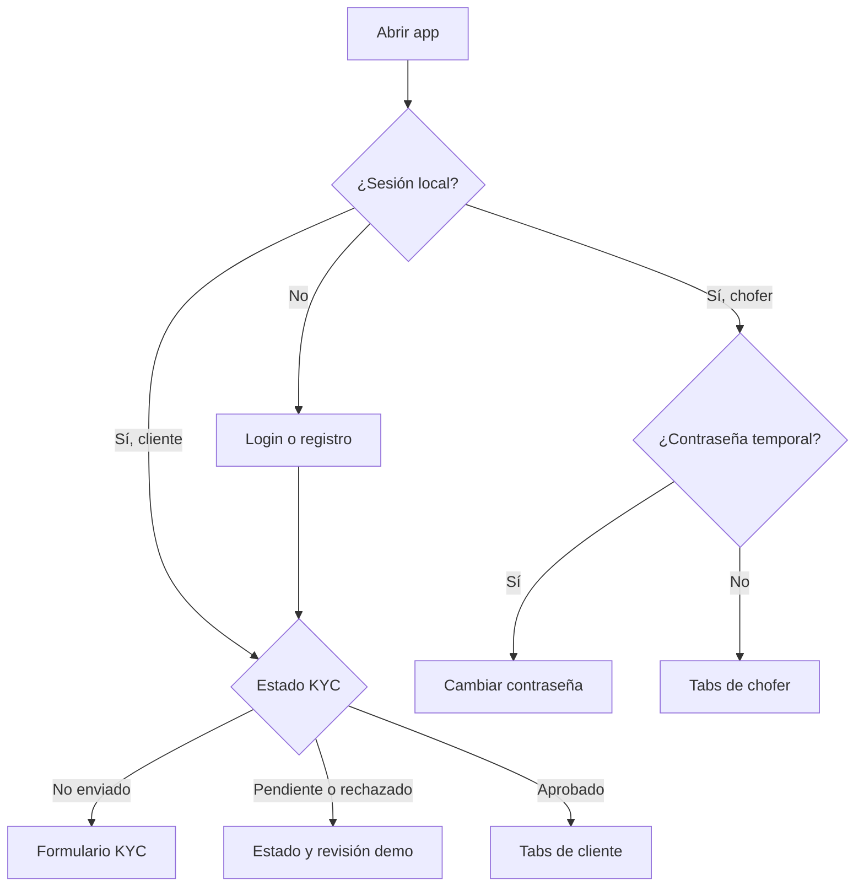
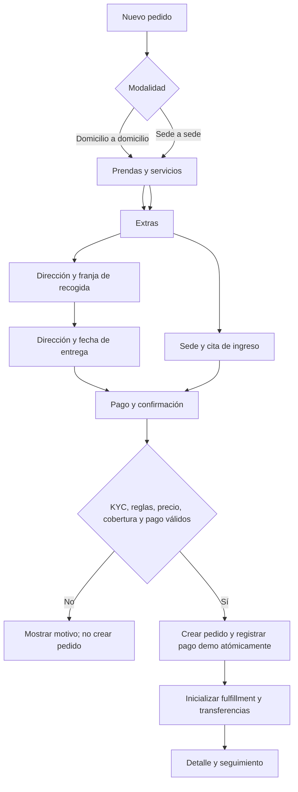
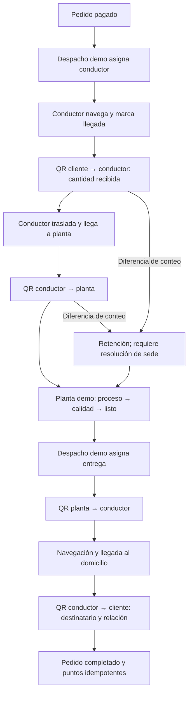
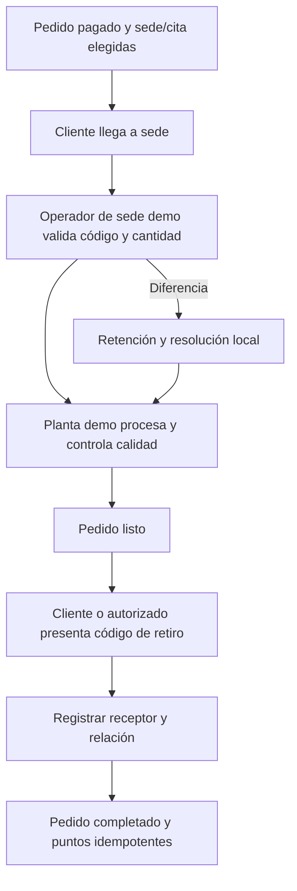
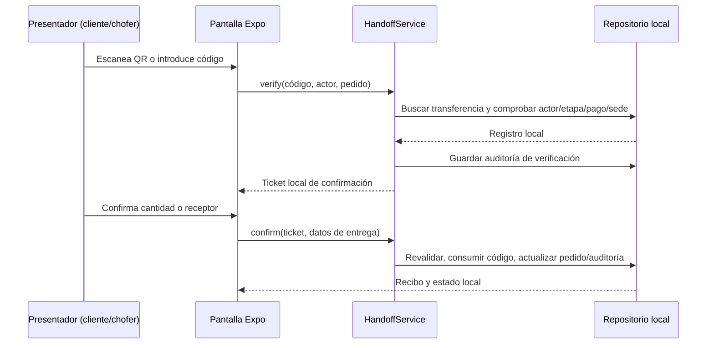
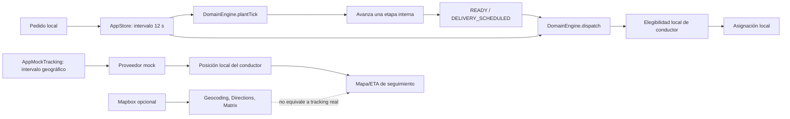
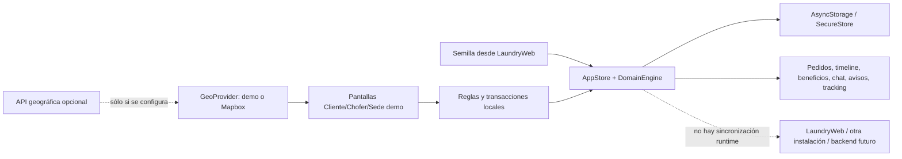

# Diagramas de flujos de LaundryApp

Los diagramas describen la app y sus servicios actuales. Las cajas locales/mock no implican llamada a un servidor.

## 1. Entrada y navegación

Las rutas de Cliente exigen sesión y KYC aprobado. Las rutas de Chofer exigen sesión del rol; el cambio de contraseña temporal se aplica en su layout.

## 2. Checkout

La estimación y el total se calculan desde catálogo, servicios, promoción, plan, recompensa, tarifa y modalidad. El código usa el mismo precio como importe cobrado; no hay ajuste de precio posterior por pesaje.

## 3. Fulfillment a domicilio

## 4. Fulfillment sede a sede

## 5. Ciclo de una transferencia

El código no se consume al verificar. La segunda validación protege la transición local contra cambios entre verificación y confirmación.

## 6. Despacho, planta y ubicación simulados

Despacho y planta se activan con conectividad porque dependen del intervalo del `AppProvider`. La posición mock se detiene cuando desconecta o la etapa ya no requiere seguimiento.

## 7. Datos y límites entre sistemas

El proveedor API geográfica solo representa un contrato HTTP de geocodificación/rutas; no es backend para pedidos, usuarios o transferencias.
